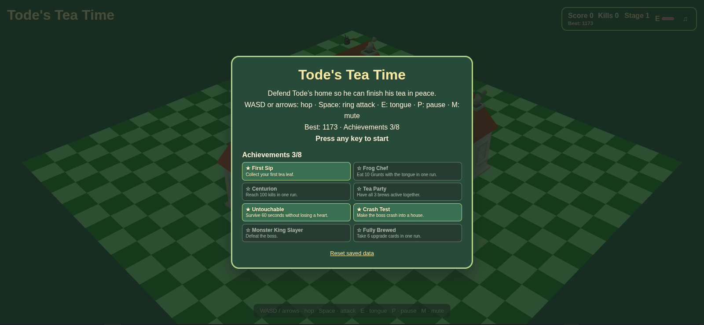
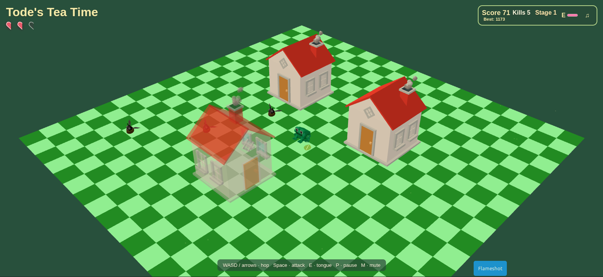
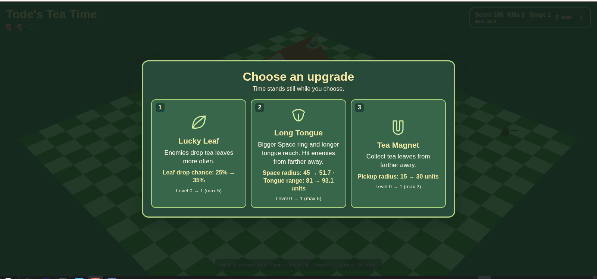

# Tode's Tea Time

**A complete 3D browser game made with Three.js, Vite, and procedurally generated audio.**

Tode the frog is trying to enjoy a quiet cup of tea, but monsters keep invading his home. Hop around the map, fight through escalating waves, collect tea leaves, and defeat the Monster King. After victory, continue the same run in Endless Mode or start fresh.

This repository began with the *Build a Game with an AI Coding Agent* course scaffold. The playable game in [`game/`](game/) extends it with tea brews, upgrades, a multi-phase boss, a tongue attack, night atmosphere, synthesized sound, achievements, and a victory ending. The course folders remain as the learning material behind the project.

## See the game

### Home and saved progress



*The start screen introduces Tode's story and controls, and shows the high score and achievements saved in this browser.*

### House occlusion fade



*A foreground house turns translucent only when it obscures an important on-screen object. Its color and the rest of the playfield remain visible. The blue tag at the lower right belongs to the screenshot tool, not the game.*

### Upgrade picker



*Scoring milestones pause the game and offer three different upgrades. Each card explains what changes and shows its current and next value.*

## Play locally

```sh
cd game
npm install
npm run dev
```

Open the local URL Vite prints. To build and preview the production version:

```sh
npm run build
npm run preview
```

The game runs entirely in the browser; it needs no server or account. High scores, achievements, and the mute setting are stored in that browser's local storage.

## Controls

| Input | Action |
| --- | --- |
| WASD or arrow keys | Hop one grid space |
| Space | Ring attack |
| E | Eat a nearby Grunt with Tode's tongue |
| P | Pause or resume |
| M | Mute or unmute |
| 1, 2, 3 or click | Choose an upgrade card |
| Enter after victory | Continue in Endless Mode |
| Space after victory or Game Over | Start a new run |

## What we built beyond the course scaffold

- **Tea leaves and brews:** defeated enemies can drop leaves for Green Tea speed, a Chamomile shield, or a Matcha Burst.
- **Survival and progression:** hearts, a score-driven upgrade picker, stacking upgrades, changing stages, and Grunt and Brute enemies.
- **Monster King:** a multi-phase boss with visible charge and stomp warnings, summoned Grunts, an enraged phase, and a house-crash weakness.
- **Combat feedback:** Tode's tongue attack, hit reactions, particles, screen shake, and clear HUD feedback.
- **Atmosphere and sound:** lighting shifts from dusk to night with fireflies and crickets. Music and effects are synthesized with the Web Audio API.
- **Reasons to replay:** a victory ending, Endless Mode, eight achievements, and a saved high score.

## Repository layout

- [`game/`](game/) — the playable Vite project; see its [game README](game/README.md) for the concise game guide.
- `Introduction/`, `Skeleton/`, `Core_loop/`, `Visual/`, `Conclusion/` — course lessons and reference material.
- Root configuration and metadata — files used by the course project.

## Credits and license

Built from the JetBrains Academy *Build a Game with an AI Coding Agent* course scaffold. The three GLB models in `game/public/models/` came with the course. The added game effects use Three.js primitives and CSS, and all game audio is generated procedurally; there are no sound files. The course material in this repository retains its [MIT license](LICENSE) and attribution.
