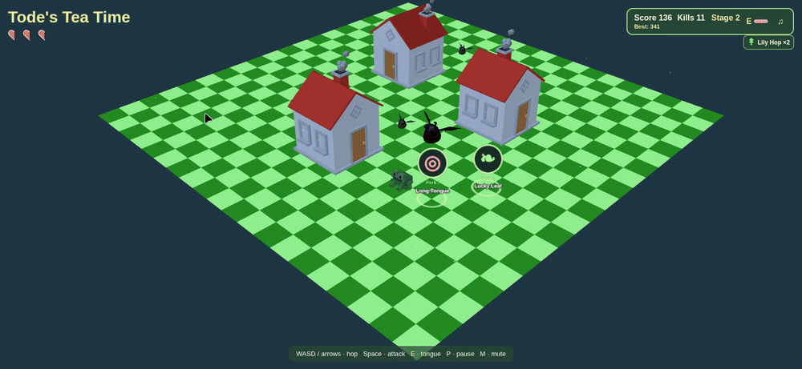
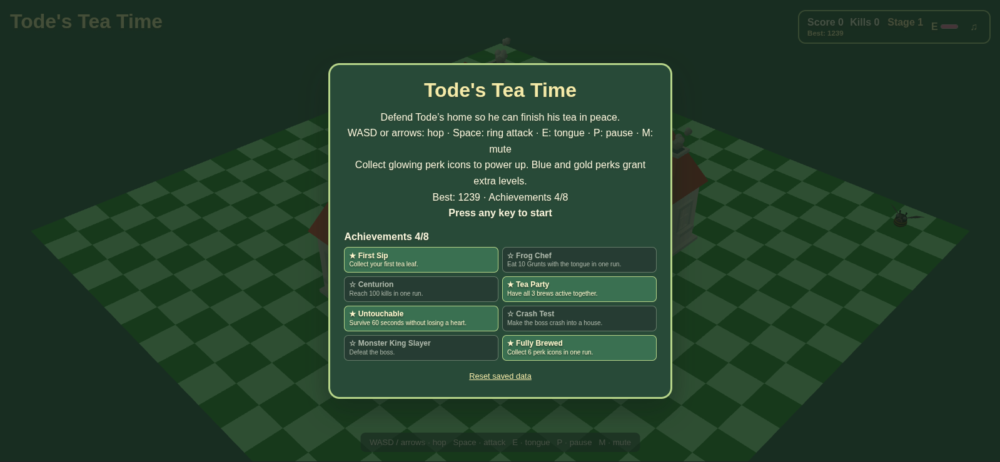
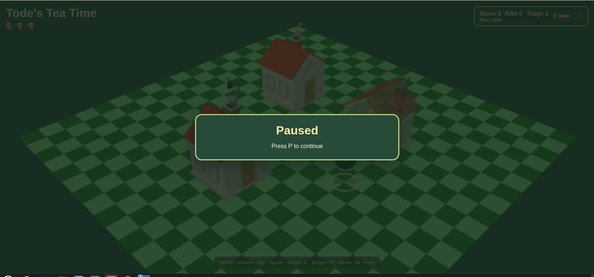
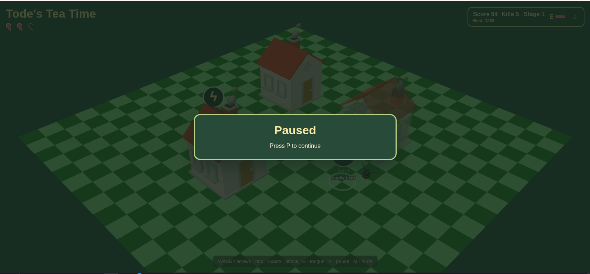

# Tode's Tea Time

**A 3D survival game about a frog defending his home so he can finish his tea.**

Hop across the checkerboard, fight monsters, collect tea and permanent powers, survive escalating swarms, and defeat the Monster King. Win to give Tode his peaceful tea break, or keep the same run going in Endless Mode.

Built with **Three.js, Vite, and the Web Audio API**. The game runs in your browser, with a local development server serving the files. No account, API key, database, or application backend is required. Character models are included; music and sound effects are synthesized in the browser.

## Gameplay



[Download the 19-second gameplay GIF](docs/submission/todes-tea-time-gameplay.gif) (10.3 MB).

## Run locally: clone to play

### Requirements

| Requirement | What you need |
| --- | --- |
| Node.js | Version **22.12 or newer**. Node 20.19+ within the 20.x series is also supported by the project's Vite dependency. |
| npm | Included with Node.js. |
| Git | For the clone commands below. Alternatively, download and extract the repository ZIP. |
| Browser | A desktop browser with JavaScript, WebGL, and hardware acceleration enabled. |
| Input | Keyboard: WASD or arrows, Space, E, P, and M. |
| Internet | Needed to clone the repository and install packages. Models and game audio require no external service during play. |

### Fresh checkout

Use the **`phase-6` branch** for this version of the game; the repository default branch contains an earlier course milestone.

Run these commands in a terminal:

```sh
git clone --branch phase-6 https://github.com/aqeelabpro/todes-tea-time.git
cd todes-tea-time/game
npm ci
npm run dev -- --host 127.0.0.1 --port 5173 --strictPort
```

Open **http://127.0.0.1:5173/** in your browser. Click the page to focus it, then press any key to start. Keep the terminal open while playing; press **Ctrl+C** in that terminal to stop the server.

If you downloaded a ZIP or already have the repository, open a terminal in its root folder and start with:

```sh
cd game
npm ci
npm run dev -- --host 127.0.0.1 --port 5173 --strictPort
```

The commands work in macOS/Linux terminals and Windows PowerShell. Run npm commands from **`game/`**, where the game's `package.json` and lockfile live. Serve the game through Vite rather than opening `index.html` directly.

### Production build and local preview

Stop the development server with **Ctrl+C**, then run these commands from `game/`:

```sh
npm run build
npm run preview -- --host 127.0.0.1 --port 4173 --strictPort
```

Open **http://127.0.0.1:4173/**. The build is written to `game/dist/`. The preview command serves that built version locally; rebuild after source changes before previewing them.

### Command reference

| Task | Command | Run from / result |
| --- | --- | --- |
| Check Node.js | `node --version` | Any folder; compare with the requirement above. |
| Check npm | `npm --version` | Any folder. |
| Clone the project | `git clone --branch phase-6 https://github.com/aqeelabpro/todes-tea-time.git` | A parent folder of your choice. |
| Enter the game after cloning | `cd todes-tea-time/game` | The folder in which you ran `git clone`. |
| Enter the game in an existing checkout | `cd game` | Repository root. |
| Install locked dependencies | `npm ci` | `game/`; use for a fresh, reproducible installation. |
| Install after intentionally changing dependencies | `npm install` | `game/`; may update the lockfile. |
| Start development with Vite's default port selection | `npm run dev` | `game/`; open the URL printed in the terminal. |
| Start development on the documented local URL | `npm run dev -- --host 127.0.0.1 --port 5173 --strictPort` | `game/`; http://127.0.0.1:5173/. |
| Build the production game | `npm run build` | `game/`; outputs `dist/`. |
| Preview the build using Vite's defaults | `npm run preview` | `game/`; open the printed URL. |
| Preview on the documented local URL | `npm run preview -- --host 127.0.0.1 --port 4173 --strictPort` | `game/`; http://127.0.0.1:4173/. |
| Stop either local server | **Ctrl+C** | The terminal running that server. |

## Suggested judge walkthrough

| Step | What to do | What to look for |
| --- | --- | --- |
| 1. Start a run | Open the local URL and press any key. | Story, controls, local best score, and eight achievement badges on the start screen. A fresh browser starts without saved achievements. |
| 2. Move and fight | Hop with WASD/arrows, use Space for a ring attack, and E near a Grunt. | Grid movement, radial combat, tongue capture, hit effects, particles, and sound. |
| 3. Collect powers | Walk over tea leaves and glowing, labeled perk icons. | Immediate powerups, a pickup notice, and owned perk levels. Perks never stop play for a card choice. The first map perk appears after about three seconds. |
| 4. Observe visibility | Move around the houses. | Houses fade when they obscure important objects, helping keep the action readable. |
| 5. Survive the first Swarm | Keep playing for 35 seconds of active game time. | A three-second warning, then eight seconds of extra enemies and faster spawning. The next Swarm starts at 70 seconds. |
| 6. Reach later stages | Keep surviving and scoring. | Faster enemies already on the map, larger groups, tougher new arrivals, Brutes, stronger perk tiers, and changing atmosphere. |
| 7. Fight the Monster King | Reach 750 actual score points. | A boss health bar, charge/stomp warnings, summoned Grunts, and an enraged phase. Lure a charge into a house to stun the boss. |
| 8. Finish and replay | Defeat the boss, then choose Enter or Space. | Victory and run statistics; Enter continues in Endless Mode and Space starts fresh. Best score and achievements persist in this browser. |

Losing a heart is recoverable: keep moving, collect tea, and use E to eat a tough Grunt in one shot. Switching tabs or leaving the game window automatically pauses the run; return and press **P** to resume.

## Screenshots

These are the three supplied captures. The arena captures deliberately show the game paused; the darkened backdrop belongs to the pause overlay. Saved scores and badges reflect the browser used for the screenshots, not a preloaded judge profile.

### Start screen and saved achievements



The home screen introduces the game and shows locally saved progress.

### Arena, house fading, and a perk pickup



The paused view shows the map layout, house visibility system, and an in-world pickup.

### A run in progress with multiple perk icons



The HUD tracks score, kills, stage, hearts, and tongue readiness while labeled powers appear in the arena.

## Controls

| Input | Action |
| --- | --- |
| Any key on the start screen | Begin a run. |
| **WASD** or **arrow keys** | Hop around the map. |
| **Space** during play | Ring attack against nearby enemies. |
| **E** | Shoot the tongue at a nearby Grunt; eating it defeats it immediately. |
| Walk over a tea leaf | Receive a tea brew. |
| Walk over a glowing perk icon | Apply its power immediately. |
| **P** | Pause or resume. |
| **M** or the music button | Mute or unmute audio. |
| **Enter** after victory | Continue the same run in Endless Mode. |
| **Space** after victory or Game Over | Start a new run. |
| Victory screen buttons | Choose Endless Mode or restart with the mouse. |
| **Reset saved data** on the start screen | Press twice to clear saved records and achievements. |

## Game features

| Feature | How it works |
| --- | --- |
| 3D arena | A checkerboard map, three houses, supplied character models, and a camera that follows Tode. |
| Grid hopping | Queued directional hops with a jump arc and obstacle/boundary collision. |
| Ring attack | A visible radial attack; range, cooldown, and damage improve through progression and perks. |
| Tongue attack | Captures and eats Grunts, with an animated extension/retraction and HUD cooldown meter. |
| Hearts and protection | Start with three hearts, gain up to five, and receive brief protection after taking damage. |
| Tea leaves | Enemy drops grant temporary speed, a shield, or an area burst. |
| Permanent perk pickups | Random labeled icons appear nearby and drop from enemies. Walk into them to gain powers without interrupting combat. |
| Stronger pickup tiers | Common, Rare, and Epic pickups grant up to one, two, or three perk levels, respecting caps. |
| Overcharge | When no eligible permanent perks remain, pickups provide temporary extra damage, faster attacks, and one heart restored. |
| Growing difficulty | Uses both score and active survival time. Existing enemies accelerate; new arrivals become tougher. |
| Crowds and spawning | Groups arrive from random points on all four edges, with a growing population limit and a minimum distance from Tode. |
| Periodic Swarms | Warned bursts add an enemy to each group and shorten spawn delays. |
| Grunts and Brutes | Grunts pursue Tode; heavier Brutes take more hits and react with stagger and knockback. |
| Monster King | A boss with multiple phases, telegraphed charges/stomps, summons, an enraged phase, and a house-crash weakness. |
| House occlusion | Houses become translucent when they cover important on-screen objects. |
| Atmosphere | Stage changes shift lighting from dusk toward night, with fireflies, glowing windows, and crickets. |
| Combat feedback | Attack rings, hit flashes, particles, screen shake, hitstop, and brief boss-phase slow motion. |
| Procedural audio | Music, ambient sound, footsteps, attacks, pickups, and boss cues are synthesized through the Web Audio API. |
| Pause and focus handling | P pauses play; tab/window focus loss pauses automatically. Gameplay timers freeze while paused. |
| Victory and Endless Mode | Defeat the first boss for an ending, then restart or continue toward later bosses. |
| Run statistics | Results show score, time, kills, hearts, leaves, perks, damage, and boss milestones. |
| Local persistence | Best results, achievement unlocks, and mute preference are saved in browser storage. |
| Eight achievements | Unlocks appear as notices during play and badges on the start/results screens. |

## Tea brews and permanent perks

### Tea leaves

A collected tea leaf normally rolls one of these brews. Some boss events deliberately provide a shield leaf.

| Brew | Effect | Duration / behavior |
| --- | --- | --- |
| Green Tea | Faster hopping. | Six seconds at 1.4× movement speed. |
| Chamomile | Blocks the next hit. | Lasts up to ten seconds; grants brief protection when consumed. |
| Matcha Burst | Blasts enemies around Tode. | Immediate area damage; defeats Grunts and damages Brutes and the boss. |

### Perk icons

Perks stay for the current run. Uncollected icons last 18 seconds and blink before disappearing; Tea Magnet increases collection range for both tea and perks. The first map perk appears after about three seconds, followed by randomized intervals that shorten as pressure rises. Brutes have a higher perk drop chance than Grunts.

| Icon | Perk | Effect | Maximum level | Availability |
| --- | --- | --- | --- | --- |
| ◎ | Long Tongue | Larger ring and longer tongue reach. | 5 | From the start. |
| ϟ | Quick Tongue | Shorter ring and tongue cooldowns. | 5 | From the start. |
| ↟ | Lily Hop | Faster movement. | 5 | From the start. |
| ∩ | Tea Magnet | Wider tea/perk collection radius. | 2 | From the start. |
| ❧ | Lucky Leaf | Greater tea-leaf drop chance. | 5 | From the start. |
| ♥ | Thick Skin | Extra maximum hearts and healing. | 2, up to five hearts | From the start. |
| ∞ | Chain Lash | Kills with the ring can trigger another area attack. | 3 | 150 pressure points or 50 seconds survived. |
| ✹ | Power Strike | Adds 0.5 damage per level to ring and chain attacks. | 3 | 150 pressure points or 50 seconds survived. |
| ★ | Overcharge | Extra damage, faster attacks, and one heart restored. | Temporary | Appears when eligible permanent perks are capped; duration scales with pickup tier. |

| Tier | Appearance | Reward | Unlock |
| --- | --- | --- | --- |
| Common | Green border, I | Up to one level. | From the start. |
| Rare | Blue border, II | Up to two levels. | 150 pressure points or 50 seconds survived. |
| Epic | Gold border, III | Up to three levels. | 450 pressure points or 150 seconds survived; boss defeats can also drop an Epic when there is room. |

Unlocks make a pickup eligible for a random roll; they do not guarantee that the next icon will have that perk or tier.

## Difficulty, enemies, and the boss

Pressure is recalculated each playing frame:

```text
pressure = max(score / 75, active_survival_seconds / 25)
```

This keeps the game escalating even if the player avoids kills. Stage and perk unlocks use `pressure × 75`; boss arrivals use the actual score.

| System | Starting behavior | How the challenge grows |
| --- | --- | --- |
| Enemy speed | Grunts move at 40 world units/second. | Every living enemy gains 14% of its type's starting speed per pressure unit, up to 4× speed. |
| Spawn delay | 2.2 seconds between groups. | Falls by 0.18 seconds per pressure unit, down to 0.45 seconds outside Swarms. |
| Group size | One enemy. | Adds one every three pressure units, up to four; Swarms add one more. |
| Population | Normal spawns initially stop at 16 enemies. | The normal-spawn limit grows to 56; boss/summon events can exceed the current normal limit while respecting the absolute cap of 56. |
| Enemy health | Grunts start with 1 HP; Brutes with 4 HP. | New arrivals gain one HP every four pressure units, up to four extra HP. Already-damaged enemies are not healed. |
| Brutes | Introduced in Stage 2. | Mixed groups become more common; Stage 3 permits up to six Brutes at once. |
| Swarms | First starts at 35 seconds. | Repeat every 35 seconds, last eight seconds, and warn three seconds ahead. Spawn delay is multiplied by 0.65 and group size increases by one. |
| Player growth | Speed, attack timing, and range improve automatically. | Automatic gains cap at +25% movement speed, +20% range, and 30% shorter attack delay; collected perks stack on top. |
| Boss strength | First boss arrives at 750 actual score. | Base health of 40 is multiplied by pressure and later-boss scaling. |

Examples outside Swarms, before enemy-type speed modifiers:

| Score or active survival time | Grunt speed | Spawn delay | Enemies per group | New Grunt HP |
| --- | --- | --- | --- | --- |
| Start | 40 | 2.20 seconds | 1 | 1 |
| 300 points or 100 seconds | 62.4 | 1.48 seconds | 2 | 2 |
| 600 points or 200 seconds | 84.8 | 0.76 seconds | 3 | 3 |

| Enemy | Behavior | Useful response |
| --- | --- | --- |
| Grunt | Pursues Tode, navigating around houses and other enemies. Later Grunts gain health. | Ring attacks for groups; the tongue can eat a Grunt regardless of its remaining health. |
| Brute | Larger, tougher pursuer with stagger, knockback, and contact recovery. | Keep moving, collect damage perks, and use repeated attacks. |
| Monster King | Charges toward a marked position, adds stomps and summons in later phases, then enrages. | Read the red warnings, leave the attack area, and lure charges into houses. A crash stuns the boss and increases ring-attack damage during that opening. |

The Monster King appears at each 750-point score milestone. Defeating the first one opens the victory screen; continuing in Endless Mode keeps the run and its escalating pressure going.

## Achievements and saved progress

| Achievement | Requirement |
| --- | --- |
| First Sip | Collect your first tea leaf. |
| Frog Chef | Eat ten Grunts with the tongue in one run. |
| Centurion | Reach 100 kills in one run. |
| Tea Party | Have all three brews active together, including the brief Matcha Burst indicator. |
| Untouchable | Survive 60 seconds without losing a heart. |
| Crash Test | Make the boss crash into a house. |
| Monster King Slayer | Defeat the boss. |
| Fully Brewed | Collect six perk icons in one run. |

Records and achievements are stored locally, not in a cloud account. They belong to the browser profile and origin: `127.0.0.1:5173`, `localhost:5173`, and `127.0.0.1:4173` have separate saves. A fresh browser/profile can therefore show zero progress even when another profile has achievements. Permanent perks belong to a run and reset on restart.

To begin judging with clean saved records, use **Reset saved data** on the start screen and press it again to confirm. If browser storage is disabled, the game can continue with in-memory progress, but records may not survive a reload.

## Troubleshooting

| Symptom | What to do |
| --- | --- |
| `node` or `npm` is not recognized | Install Node.js, reopen the terminal, and check `node --version` and `npm --version`. |
| Unsupported Node version / Vite startup error | Use Node 22.12+ or a supported Node 20.19+ release. |
| Missing script or wrong project starts | Enter `game/` before running npm commands; the repository root contains course/project metadata. |
| `npm ci` fails | Check the first reported error, your Node version, network access, and registry access. Use the repository's included `game/package-lock.json`. |
| Port 5173 or 4173 is occupied | Stop the other server, or use `npm run dev` / `npm run preview` without a fixed port and open the URL Vite prints. |
| Blank page or missing models after opening an HTML file | Use the local server and its HTTP URL; do not open the game using `file://`. |
| WebGL error or the arena does not render | Enable browser hardware acceleration and use a browser/device with WebGL support. |
| No sound | Click the game or press a key to unlock browser audio, then check M, the music button, and system volume. |
| Game says Paused after returning to it | Focus the game tab and press P. This is the automatic focus-loss pause. |
| Controls do not respond | Click the page to focus it; start the run or resume with P as appropriate. |
| Previous high score is missing | Use the same browser profile and the same host/port as before. |
| Preview shows an older version | Stop preview, run `npm run build`, restart preview, and refresh the page. |

## Project map

Paths below are relative to `game/`.

| Path | Purpose |
| --- | --- |
| [`package.json`](package.json) / [`package-lock.json`](package-lock.json) | Dependencies, reproducible installation, and dev/build/preview commands. |
| [`vercel.json`](vercel.json) | Vite framework, install/build commands, and production output directory for Vercel. |
| [`index.html`](index.html) | Browser entry point and game canvas. |
| [`src/main.js`](src/main.js) | Animation loop, input, combat integration, and run lifecycle. |
| [`src/config.js`](src/config.js) | Difficulty, waves, enemy stats, perk/drop tuning, effects, audio, and achievement definitions. |
| [`src/Difficulty.js`](src/Difficulty.js) | Score/time pressure, Swarm timing, and scaling calculations. |
| [`src/components/`](src/components/) | Player, enemies, boss, world, tea, perks, tongue, HUD, audio, atmosphere, saves, and achievements. |
| [`src/style.css`](src/style.css) | HUD, overlays, notices, and UI animation styles. |
| [`public/models/`](public/models/) | Bundled Tode, enemy, and house GLB models. |
| [`docs/screenshots/`](docs/screenshots/) | The three supplied screenshots used in this README. |
| `dist/` | Generated production output after `npm run build`; not committed. |

## Credits and license

Built from the JetBrains Academy *Build a Game with an AI Coding Agent* course scaffold. The Tode, enemy, and house GLB models came with the course. Added visual effects use Three.js primitives and CSS; game audio is generated procedurally through the Web Audio API, with no sound files or external audio service.

The repository's course material retains its [MIT license and attribution](../LICENSE). The [repository overview](../README.md) provides the original project context; this guide documents the current playable game and its local evaluation steps.
